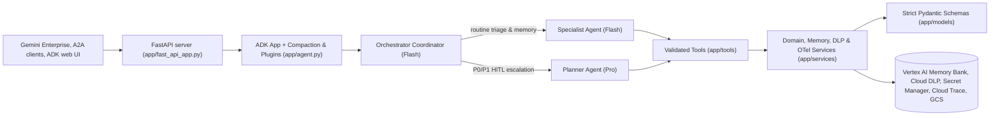
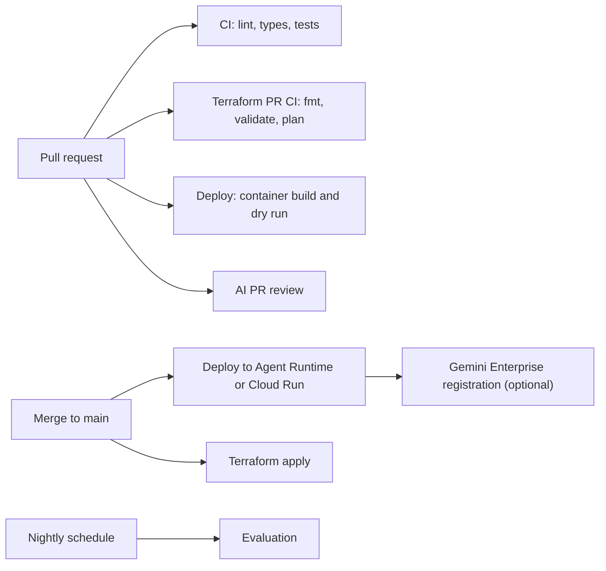

# ADK Starter

A production-ready foundation for **Google ADK multi-agent applications** served by FastAPI (ADK API + A2A), deployable to **Vertex AI Agent Runtime** or **Cloud Run**, with offline CI, an **AI pull request reviewer**, Terraform with Workload Identity Federation, and optional **Gemini Enterprise** registration.

## What's inside

| Area | What you get |
| --- | --- |
| **Agents** | Multi-agent ADK 2.x `App` with an `orchestrator_agent` coordinator (`gemini-3-flash-preview`), a Flash-tier `specialist_agent`, a Pro-tier `planner_agent` (`gemini-3.1-pro-preview`), and a deterministic `SequentialAgent` workflow |
| **Context & Memory** | Native `EventsCompactionConfig`, background observation extraction (`AsyncMemoryConsolidationPlugin`), and user-scoped persistent memory (`VertexAiMemoryBankBackend` with an in-memory vector store fallback) |
| **Guardrails & Observability** | `DomainErrorGuardPlugin` (prompt-injection shield, human-in-the-loop confirmation gate, grounded self-evaluation, PII scrubbing via `PiiRedactionService`) and `ObservabilityPlugin` (structured JSON audit logs and OpenTelemetry tracing) |
| **Serving** | FastAPI server exposing the ADK API, A2A (`/a2a/app`), and Agent Runtime routes with `SecretManagerService` secret resolution; a single `Dockerfile` serves both deployment targets |
| **Quality** | `ruff`, `mypy --strict` (zero `Any`), offline `pytest` (80% coverage floor), architecture and workflow guard tests, and a live evaluation suite (`agents-cli eval run`) |
| **CI/CD & IaC** | GitHub Actions for CI, container builds, deployment (`agents-cli deploy`), Terraform (`aiplatform`, `dlp`, `secretmanager`, `cloudtrace`, `discoveryengine`, WIF), nightly evaluation, and AI code review |
| **Guidelines** | [`AGENTS.md`](AGENTS.md): engineering contract for contributors, coding agents, and the AI reviewer |

## Getting started

**Prerequisites:** [uv](https://docs.astral.sh/uv/), the [gcloud CLI](https://cloud.google.com/sdk/docs/install), and—for provisioning—[Terraform](https://developer.hashicorp.com/terraform/install) ≥ 1.15 and the [GitHub CLI](https://cli.github.com/).

### 1. Install and verify

```bash
make install   # uv sync --frozen (Python 3.12, dev tools included)
make check     # lint, mypy --strict, offline tests + coverage
```

### 2. Run the agent locally

```bash
cp .env.example .env                       # set GOOGLE_CLOUD_PROJECT
gcloud auth application-default login
gcloud services enable aiplatform.googleapis.com --project my-gcp-project
make playground                            # ADK web UI
make run PROMPT="What can you do?"         # one-shot prompt
make serve                                 # production FastAPI app on :8080
curl -s localhost:8080/a2a/app/.well-known/agent-card.json
```

### 3. Provision Google Cloud and wire GitHub

Requires Owner (or equivalent) on the Google Cloud project and admin rights on the GitHub repository.

```bash
gcloud auth login && gcloud auth application-default login
gh auth login
make bootstrap PROJECT_ID=my-gcp-project PREFIX=acme
```

Then enable a Claude model in [Vertex AI Model Garden](https://console.cloud.google.com/vertex-ai/model-garden) for the AI reviewer and protect `main` (see [CI/CD](#cicd)). Every pull request will run CI, a Terraform plan, a deployment dry run, and the AI review, and every merge to `main` deploys.

## Repository layout

```text
.
├── app/                      # ADK application (layering rules: AGENTS.md §5.8)
│   ├── agent.py              # Composition root: the ADK App
│   ├── agents/               # One package per agent (agent.py + prompts.py), model ids, state keys
│   ├── tools/                # Thin ADK tool adapters
│   ├── services/             # Business logic and cloud clients (ADK-free)
│   ├── models/               # Pydantic schemas, StrEnums, domain exceptions
│   ├── plugins/              # Cross-cutting ADK callbacks and guards
│   ├── app_utils/            # Serving glue: A2A, session/artifact services, runtime adapter
│   └── fast_api_app.py       # FastAPI server
├── tests/
│   ├── unit/                 # Offline tests mirroring app/, plus repository guard tests
│   └── eval/                 # Live evaluation dataset and metrics (agents-cli)
├── scripts/
│   ├── bootstrap_gcp.sh      # One-shot Google Cloud + GitHub provisioning
│   ├── deploy.sh             # Single deployment entry point (CI, make deploy, bootstrap)
│   ├── init_project.py       # `make init` template initializer
│   └── ci/                   # AI review publisher (digest-verified, idempotent)
├── terraform/                # Google Cloud foundation
├── .github/
│   ├── workflows/            # CI, deploy, Terraform, evaluation, AI review
│   └── prompts/              # AI reviewer instructions
├── AGENTS.md                 # Engineering contract
├── CLAUDE.md                 # Claude Code entry point (imports AGENTS.md)
├── Dockerfile                # Runtime image for both deployment targets
├── Makefile                  # Developer entry points (`make help`)
└── agents-cli-manifest.yaml  # agents-cli project settings
```

## Architecture



- **Agents** are constructed via factories (`create_<name>_agent(*, model)`) with prompts in each agent's `prompts.py` and model identifiers centralized in `app/agents/constants.py`.
- **Tools** validate LLM inputs and outputs with frozen `extra="forbid"` Pydantic schemas, delegate business logic to ADK-free services in `app/services/`, and record session state under canonical keys from `app/agents/state.py`. `DomainErrorGuardPlugin` converts `AgentDomainError` exceptions into recoverable tool responses and gates high-stakes tools behind explicit human-in-the-loop confirmation (`status="awaiting_confirmation"`).
- **Serving**: the same container serves the ADK API (`/run_sse`, sessions), A2A (`/a2a/app`), and the Agent Runtime `query`/`stream_query` routes. Sessions and memories use Vertex AI Agent Engine / Memory Bank when configured (resolving `secret://` URIs via `SecretManagerService`) and fall back to local in-memory stores offline.

## CI/CD



| Workflow | Trigger | Needs Google Cloud | What it does |
| --- | --- | --- | --- |
| **CI** (`ci.yml`) | PRs and pushes to `main` | No | `Fast Offline CI`: ruff, mypy, pytest with coverage. `Shell & Workflow Lint`: ShellCheck and actionlint |
| **Deploy** (`deploy.yml`) | PRs and pushes to `main` touching the app or its packaging | Build: no. Deploy: yes | PR: `docker build` plus `scripts/deploy.sh --dry-run`. `main`: `scripts/deploy.sh`, then Gemini Enterprise registration when configured |
| **Terraform PR CI** (`tf-ci.yml`) | PRs touching `terraform/` | Static: no. Plan: yes | `Terraform Static Checks`: `fmt -check`, `init -backend=false`, `validate`. `Terraform Plan`: plan posted as a PR comment |
| **Terraform Main Apply** (`tf-apply.yml`) | Pushes to `main` touching `terraform/`, manual | Yes | Plan and apply (queued, never cancelled mid-apply) |
| **AI PR Review Agent** (`review-agent.yml`) | Same-repository PRs | Yes | Claude on Vertex AI reviews the diff against `AGENTS.md` |
| **Nightly Evaluation** (`eval.yml`) | Daily at 18:00 UTC, manual | Yes | `agents-cli eval run` with Vertex AI grading; results uploaded as an artifact |

- Jobs that need Google Cloud are **skipped, not failed**, until `make bootstrap` sets `GCP_WIF_PROVIDER`, and they never run for pull requests from forks or Dependabot.
- Authentication uses Workload Identity Federation only; no service account keys or secrets are stored.
- Every action is pinned to a commit SHA, tokens are least-privilege, and untrusted input never reaches a `run:` script (`tests/unit/test_workflows.py`).
- Recommended branch protection for `main`: require pull requests with at least one human approval and the status checks `Fast Offline CI` and `Shell & Workflow Lint`.

## AI PR review agent

Every same-repository pull request is reviewed by Claude (Claude Code Action on Vertex AI) against [`AGENTS.md`](AGENTS.md) and [`.github/prompts/review-instructions.md`](.github/prompts/review-instructions.md). Prior findings are loaded from the sticky summary comment so repeated runs converge, and `scripts/ci/publish_review.py` (staged outside the workspace and SHA-256 verified before the model runs) posts inline comments and updates one sticky summary. The review is **advisory**: merging always requires human approval (AGENTS.md §8.4). Tailor domain rules in `AGENTS.md` §3.2 and optionally set the repository variable `REVIEW_MODEL` (default `claude-opus-5-5@default`).

## Infrastructure and bootstrap

All resource names derive from a 3–16 character `PREFIX`, so multiple agents can share one Google Cloud project without sharing state.

| Resource | Name | Purpose |
| --- | --- | --- |
| Terraform state bucket | `<project>-<prefix>-tfstate` | Versioned remote state with uniform access and public access prevention |
| Artifacts bucket | `<project>-<prefix>-logs` | ADK artifacts (`LOGS_BUCKET_NAME`) |
| Exports bucket | `<project>-<prefix>-exports` | User-facing exports (`EXPORTS_BUCKET_NAME`); 7-day object lifecycle |
| Runtime service account | `<prefix>-runtime-sa` | Identity of the deployed agent |
| CI/CD service account | `<prefix>-cicd-sa` | Impersonated by GitHub Actions (CI/CD mode only) |
| Workload Identity pool / provider | `<prefix>-github-pool` / `<prefix>-github-provider` | Restricted to this repository (CI/CD mode only) |
| Artifact Registry | `<prefix>-repo` | Cloud Run container images |
| APIs and IAM | `services.tf`, `iam.tf` | Vertex AI, Agent Runtime, Cloud Run, Discovery Engine, telemetry (`additional_services` adds more) |

`scripts/bootstrap_gcp.sh` (wrapped by `make bootstrap`) is idempotent and supports two modes:

```bash
# CI/CD mode (default): provision resources and publish GitHub repository variables.
make bootstrap PROJECT_ID=my-gcp-project PREFIX=acme

# Hand-off mode: no GitHub integration; provision runtime resources and deploy once.
./scripts/bootstrap_gcp.sh --project-id my-gcp-project --prefix acme --no-cicd --deploy
```

Useful options: `--region` (default `asia-northeast1`), `--deployment-target agent_runtime|cloud_run`, `--github-repo owner/name`, `--service-name`, `--yes`. Run `./scripts/bootstrap_gcp.sh --help` for the full list. In CI/CD mode, `make bootstrap` automatically populates all required GitHub Actions repository variables (`GCP_PROJECT_ID`, `GCP_PROJECT_NUMBER`, `GCP_REGION`, `RESOURCE_PREFIX`, `DEPLOYMENT_TARGET`, `GCP_WIF_PROVIDER`, `GCP_CICD_SA`, `GCP_RUNTIME_SA`, `ARTIFACT_REPO`, `LOGS_BUCKET_NAME`, `EXPORTS_BUCKET_NAME`, `SERVICE_NAME`) from the Terraform output `github_actions_variables`. You can also optionally set `GEMINI_ENTERPRISE_APP_ID` and `REVIEW_MODEL`.

> [!WARNING]
> Applying Terraform with `enable_cicd = false` against an environment that already has CI/CD **destroys** the Workload Identity pool and CI/CD service account. `bootstrap_gcp.sh` refuses `--no-cicd` once the pool exists in state, and the workflows always pass `enable_cicd = true`.

> [!IMPORTANT]
> **CI/CD service account scope.** `<prefix>-cicd-sa` includes `roles/editor`, `roles/storage.admin`, `roles/artifactregistry.admin`, and `roles/iam.securityAdmin` so `Terraform Main Apply` can manage project resources and IAM bindings. Because the Workload Identity binding trusts workflow runs across branches of the repository, protect `main`, restrict who can push branches, and narrow `cicd_sa_roles` in `terraform/iam.tf` before using a production project.

## Deployment

`scripts/deploy.sh` is the single deployment entrypoint for CI, `make deploy`, and `bootstrap_gcp.sh --deploy`. It wraps `agents-cli deploy` and reads configuration from environment variables (`./scripts/deploy.sh --help`).

| | Agent Runtime (default) | Cloud Run |
| --- | --- | --- |
| Build | Agent Runtime builds the `Dockerfile` remotely from the source upload (filtered by `.gcloudignore`) | `deploy.yml` builds and pushes the image to Artifact Registry; local deploys build from source |
| Runtime identity | `GCP_RUNTIME_SA` | `GCP_RUNTIME_SA` |
| Gemini Enterprise | Registered as an ADK agent | Registered as an A2A agent via its agent card |

- Switch targets by updating `DEPLOYMENT_TARGET` and re-running bootstrap with `--deployment-target`.
- Override sizing defaults (`4Gi`, 2 CPU, concurrency 8, 0–10 instances) via `DEPLOY_MEMORY`, `DEPLOY_CPU`, `DEPLOY_CONCURRENCY`, `DEPLOY_MIN_INSTANCES`, and `DEPLOY_MAX_INSTANCES`.
- **Gemini Enterprise:** set `GEMINI_ENTERPRISE_APP_ID` to `projects/<project-number>/locations/<location>/collections/default_collection/engines/<app-id>` and re-run `GEMINI_ENTERPRISE_APP_ID=... make bootstrap PROJECT_ID=... PREFIX=...`.
- Deploy locally:
  ```bash
  export GCP_PROJECT_ID=my-gcp-project GCP_REGION=asia-northeast1 SERVICE_NAME=acme-invoice-agent
  make deploy ARGS=--dry-run   # validate
  make deploy                  # deploy
  ```

## Make targets

| Target | Description |
| --- | --- |
| `make init NAME=... [DISPLAY_NAME=...]` | Turn the template into your project |
| `make install` / `make lock` | Install dependencies from `uv.lock` / re-resolve `uv.lock` against public PyPI |
| `make lint` / `make format` | Ruff, ShellCheck, and actionlint / auto-fix and format |
| `make typecheck` | `mypy --strict` over `app`, `tests`, and `scripts` |
| `make test` | Offline unit tests with the coverage gate |
| `make check` | Everything CI runs on a pull request |
| `make playground` / `make run PROMPT=...` / `make serve` | ADK web UI / one-shot prompt / production server on `:8080` |
| `make eval` | Live evaluation (see [`tests/eval/README.md`](tests/eval/README.md)) |
| `make tf-fmt` / `make tf-validate` | Format / validate Terraform without remote state |
| `make bootstrap PROJECT_ID=... PREFIX=... [ARGS=...]` | Provision Google Cloud and wire GitHub |
| `make deploy [ARGS=--dry-run]` | Deploy from your machine |

## Customization checklist

- [ ] Run `make init NAME=your-agent-name` and update this README's introduction.
- [ ] Write your domain rules in `AGENTS.md` §3.2 for the AI reviewer.
- [ ] Replace the example domain models (`app/models/schema.py`), services (`app/services/`), tools (`app/tools/`), and unit tests.
- [ ] Customize the agent tree under `app/agents/` (each with `agent.py` and `prompts.py`) and register agent names in `AgentName`.
- [ ] Add evaluation cases in `tests/eval/datasets/basic-dataset.json`.
- [ ] Bootstrap Google Cloud, enable the Claude model for the reviewer, and configure branch protection.

## Troubleshooting

| Symptom | Fix |
| --- | --- |
| `test_uv_lock_only_uses_public_pypi` fails, or CI cannot download packages | `uv.lock` contains a custom package index. Run `make lock`. |
| Google Cloud jobs show as skipped | Expected until `make bootstrap` sets `GCP_WIF_PROVIDER`; they also skip for fork pull requests. |
| `google-github-actions/auth` fails with `403` / `iam.serviceAccounts.getAccessToken` denied | Re-run bootstrap with `--github-repo owner/name` after renaming or transferring the repository. |
| The AI review fails with a model `404` or permission error | Enable the Claude model in Vertex AI Model Garden, or set `REVIEW_MODEL` to an enabled model. |
| Gemini returns `404 NOT_FOUND` locally | Gemini 3.x is served from `global`: set `GOOGLE_CLOUD_LOCATION=global`. |
| Agent Runtime deployment rejects a flag | Agent Runtime builds from source (`IMAGE_URI` is ignored, `--agent-version` is unsupported). Keep `Dockerfile` out of `.gcloudignore`. |
| `make init` prints "Nothing to do" | The repository has already been initialized with a custom project name. |

## License & Compliance

Licensed under the [Apache License, Version 2.0](http://www.apache.org/licenses/LICENSE-2.0).
